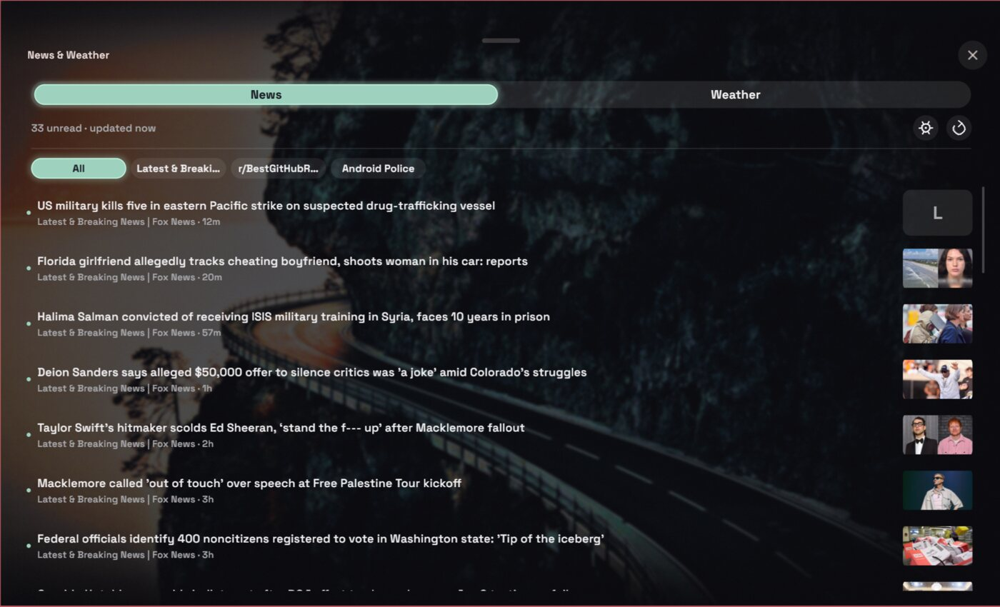
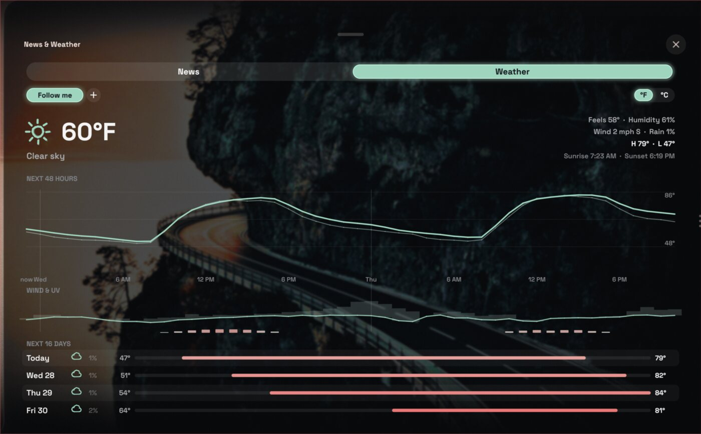
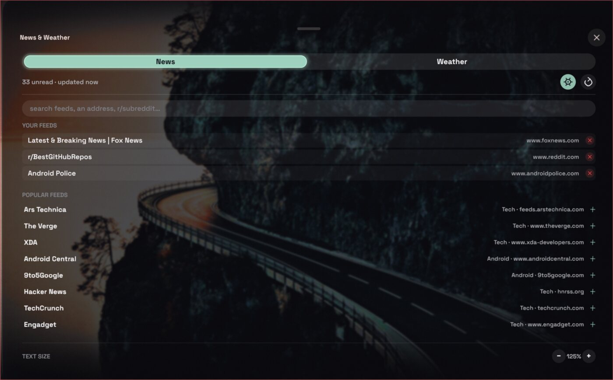

# News & Weather

A [Vitreus](https://github.com/natepayn3/Vitreus) add-on: an RSS reader and a forecast in one drawer out of the add-on pill, drawn in the shell's own boiled pencil.

## What it does

- **News:** an RSS / Atom reader.
  - Chips filter by source, stories show thumbnails, and read stories fade.
  - A click opens a story; a right-click marks it read. "Mark all read" and refresh are at the top.
  - The gear opens the feed manager. Type a known feed's name, a site's address, or `r/subreddit`. The popular feeds narrow as you type. Ctrl+V pastes into the field, and Enter adds the first match.
  - The text size can be changed with − and + under **Text size**, at the bottom of the feed manager.
- **Weather:** an [Open-Meteo](https://open-meteo.com) forecast.
  - Current conditions.
  - The next 48 hours as graphs: temperature and feels-like, chance of rain, wind and gusts, UV. Hover an hour to see its numbers.
  - The next 16 days as range bars.
  - Saved places (+ to look one up), "Follow me", and °F / °C.

It looks and moves as Vitreus's other panels do:
- the pencil only boils on what is in use or under the pointer, and holds still on the Proxy theme;
- colours come from the shell's palette;
- the tab, chip, place and unit highlights are the theme's own (`PThumb`).

## Install

Copy this folder to `~/.config/pleamar/vitreus-addons/news-weather/`, then turn it on in Vitreus's **Settings › Add-ons**.

It needs two programs:
- `vitreus-feedfetch`, which is part of Vitreus (its `install.sh` links it into `~/.local/bin`);
- `curl`.

No account and no API key.

## What it sends where

Nothing is sent anywhere you did not set up. It talks to:
- **the feeds you add**: their addresses are fetched by `vitreus-feedfetch`, every 15 minutes by default;
- **Open-Meteo**: `api.open-meteo.com` for the forecast, with the coordinates of the place shown, and `geocoding-api.open-meteo.com` for the places you look up by name;
- **"Follow me"**: it uses the location set in Vitreus's own weather settings. If none is set, it asks [ipwho.is](https://ipwho.is) to place you by your IP address.

It keeps everything in its own data folder, `~/.local/share/pleamar/news-weather/`:
- `news.json`: your feeds and settings (its header in `news-weather.luau` lists every key);
- `news-state.json`: what was read;
- `news-cache.json`: the last stories, shown at once on the next start;
- `weather.json`: the saved places, by their coordinates.

It keeps no passwords or tokens.

## Files

| File | What it is |
|---|---|
| `news-weather.plm` | the panel |
| `news-weather.luau` | its logic: fetching, the feed manager, places |
| `addon.toml` | what Vitreus reads to list and run it |
| `addon-palette.plm`, `addon-theme.plm`, `addon-pencil.plm`, `pencil-glyphs.plm` | copies of Vitreus's own pieces (MIT) for the palette, the theme, the pencil and its icons; refresh them from Vitreus when it changes them |

## Credits

- The design and the first version are jaslrobinson's ([Vitreus issue #22](https://github.com/natepayn3/Vitreus/issues/22)).
- natepayn3 moved it onto Vitreus's add-on system.
- The pencil pieces are Vitreus's (natepayn3, MIT).

An AI assistant (Claude) helped write parts of this add-on, including the move to the pencil style, and this README.

## Licence

MIT: see `LICENSE`.
