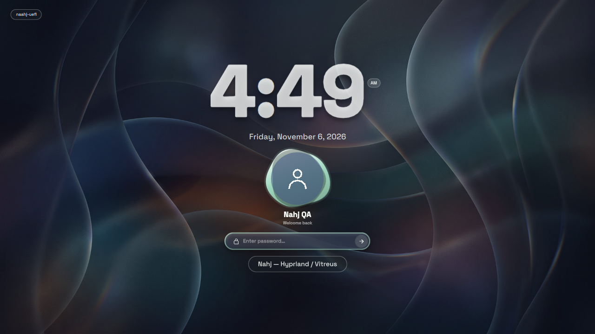
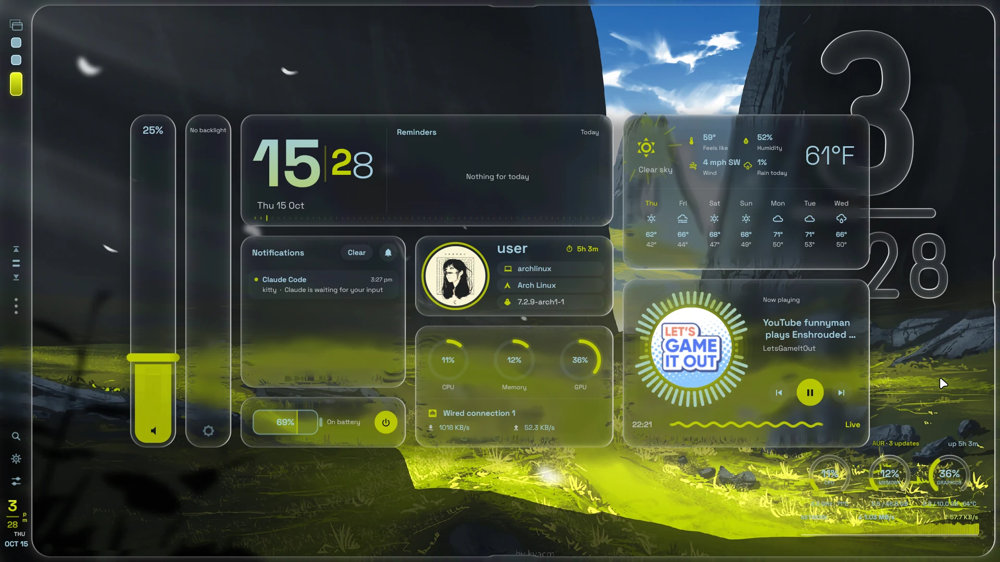

# تسجيل الدخول والديسكتوب الأصلي

## شاشة تسجيل الدخول — لقطة فعلية

لقطة 6 نوفمبر 2026 من نظام مثبت داخل QEMU، بعد فصل ISO، باستخدام شاشة SDDM الأصلية. نجحت المصادقة بكلمة المرور المختارة أثناء التثبيت. هذه لقطة تاريخية؛ لا تثبت اكتمال سطح المكتب أو سلاسة أحدث ISO.

[تفاصيل اختبار تسجيل الدخول](installed-2026-11-06/README.md).

## الديسكتوب شيل — صورة مرجعية من المشروع الأصلي

الصورة التالية من ملفات المشروع الأصلي، بدون تعديل أو إعادة رسم. **ليست لقطة من ISO Nahj الحالية**؛ لا توجد لقطة مكتملة مقبولة تثبت تطابق الجلسة الحالية مع هذا المرجع.

[المعرض الأصلي الكامل](shell-reference/README.md) · [المصادر والبصمات](shell-reference/sources.json).

## نتائج الفحص ولقطات الإقلاع

- [تقرير 20 نوفمبر: القياسات وحدودها](../docs/nahj/tests-2026-11-20/README.md).
- [أحدث بناء موثّق ISO09: الإقلاع وفشل اكتمال الواجهة](iso09-2026-11-13/README.md).
- [لقطات قوائم وإقلاع ISO القديمة](iso-runtime/README.md).
- [معاينات فيديو الإقلاع](boot/): معاينات مولّدة من الفيديو، وليست لقطات من ISO تعمل.

أُزيلت لقطات جلسة الديسكتوب التشخيصية القديمة المرفوضة ومراجعها من الملفات الحالية. لقطة ثابتة أو نجاح البناء وحده لا يثبت سلاسة الحركة.
