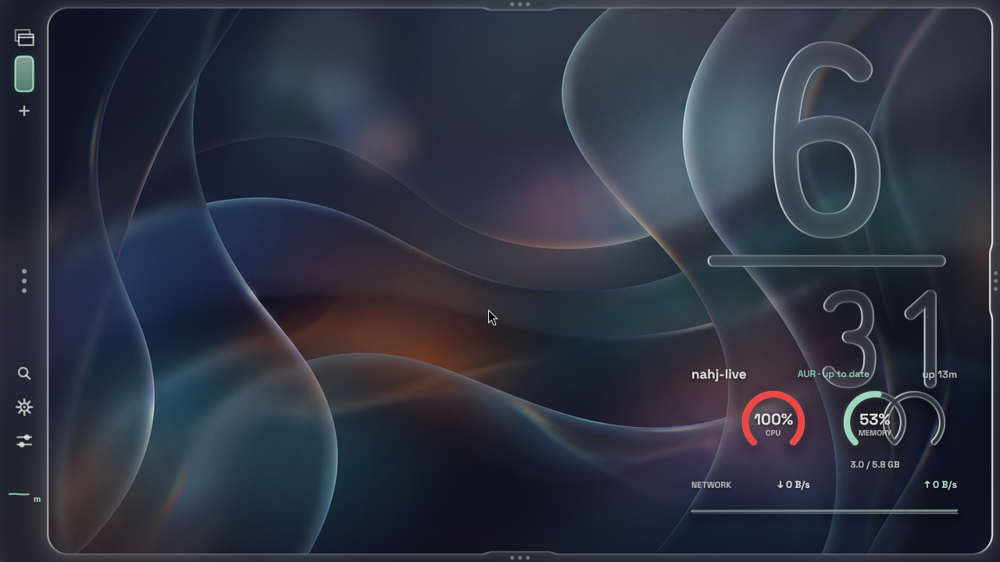

# Frame: actual ISO runtime diagnostics

This is an actual QEMU screenshot of the Frame ISO from GitHub run 40794212158 (commit 2f6626b; ISO SHA256 0b75150aa9860fc40453cc42f186c511a0a776a4658543fb06ceee2bf772273b). It is not a recreation, source-asset screenshot or a claim that the desktop is finished.

The cloud machine has no KVM or GPU. On QEMU TCG / llvmpipe, the shell's Luau initialization exceeded its two-second deadline; a diagnostic restart still recorded that error. The wallpaper helper was invoked manually. Other scenes were temporarily paused to diagnose CPU contention and resumed before this capture. Hypridle was stopped for this test. The shell was launched directly with its original executable, scene and session environment. No original shell code or theme was edited; the Luau file's modification time was touched to request its built-in reload.

Known visible problems: at 1280×720, the clock and monitor overlap and the lower part of the left strip is clipped. The original reference is 1920×1080. Rendering is extremely slow here (one diagnostic first frame took 70.8 seconds, with subsequent 20–36 second frames). The memory/graphics rings also appear overlapped. This image does not prove working drawers, completed initialization, smooth animations or VirtualBox support. Higher-resolution capture and fault investigation are ongoing.

The wallpaper is the repository's original greeter asset; the reference's ocean video is not included in the fork. The wallpaper picker and transition sources remain unchanged.
