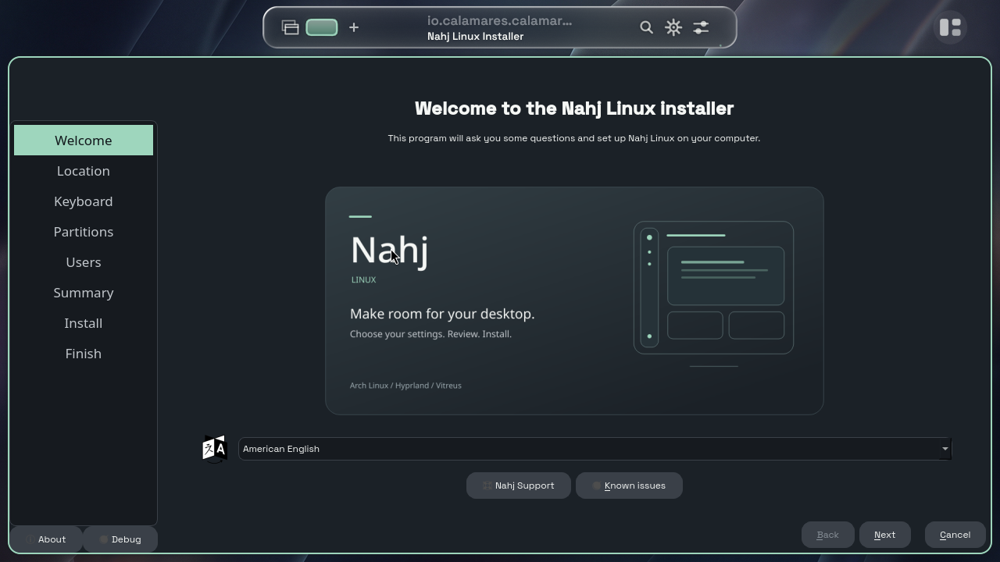

# Installer design review

Captured from the running BIOS live guest, not a mock-up. The installed Calamares process loaded the SVG and branding files from commit b8cd3dd, copied into the live guest for review. The boot-video image is no longer used in the installer.

This is the older d5bb7e3 diagnostic ISO session: its old horizontal Island bar is paused to free CPU for installer testing. It is **not** a screenshot of the corrected Frame desktop and does not establish animation performance. The new ISO build packages these installer changes; fresh Frame captures are separate. Calamares was launched with debug logging for this test (hence its Debug button).
