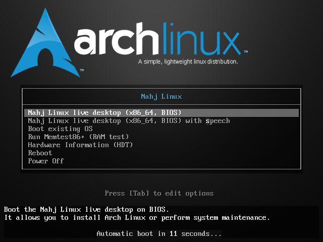
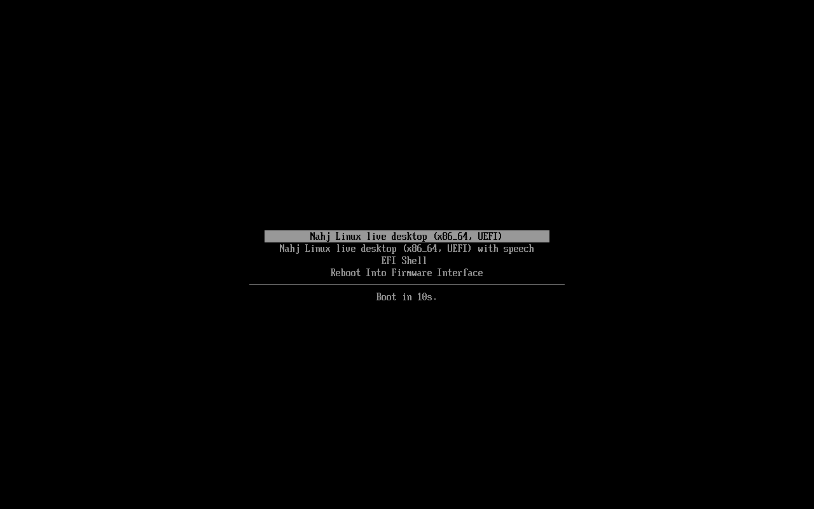

# لقطات فعلية من نسخة ISO

هذه لقطات QEMU مباشرة من ملف `nahj-2026.10.28-x86_64.iso` الناتج عن [بناء GitHub الناجح](https://github.com/9a6r/Nahj-linux/actions/runs/40646940152)، عند commit `d5bb7e3bee286148613ecee72ac44be68af331e0`.

بصمة SHA256 المطابقة: `5d4cd12fc7c592ee4cc56a540d272b0f82c92820af633750751fbbdce074aa43`.

الاختبار يستخدم QEMU 11.1.2، محاكاة TCG، أربع وحدات معالجة افتراضية، 6 GiB ذاكرة وVirtio VGA؛ لا يوجد KVM أو GPU في بيئة الاختبار. اللقطات أدناه تثبت مراحل الإقلاع الموضحة فقط؛ اختبار سطح المكتب والتثبيت ما زال جاريًا.

قائمة BIOS:

شاشة Plymouth داخل الآلة الافتراضية أثناء الإقلاع:

قائمة UEFI باستخدام OVMF:

