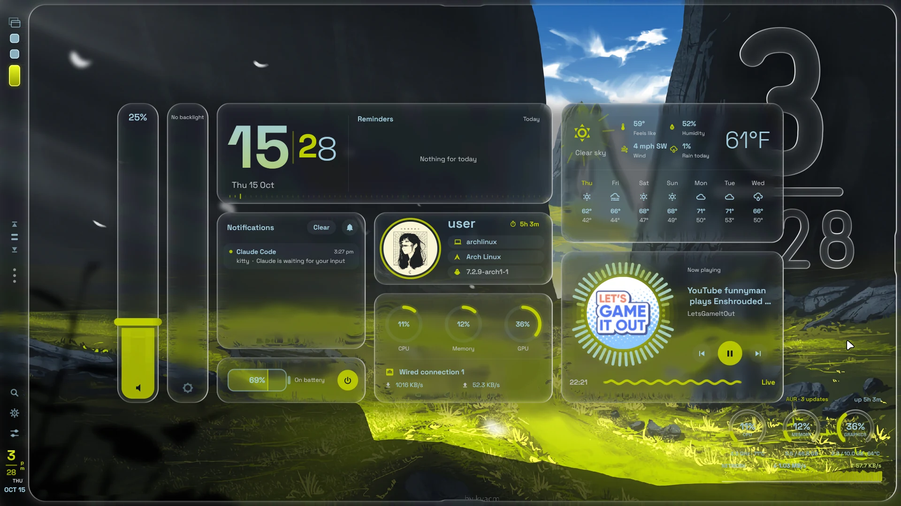
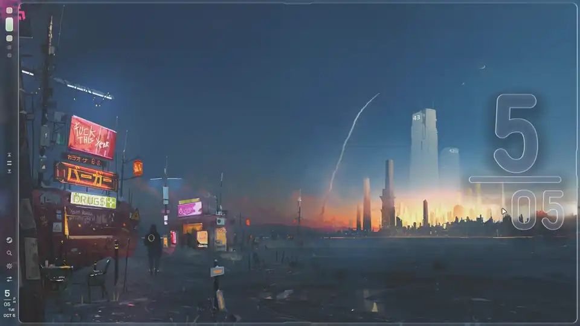
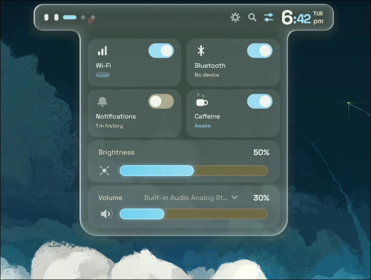
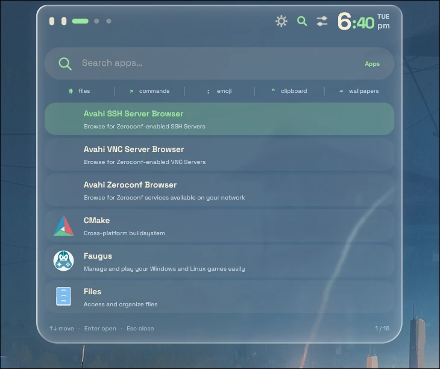
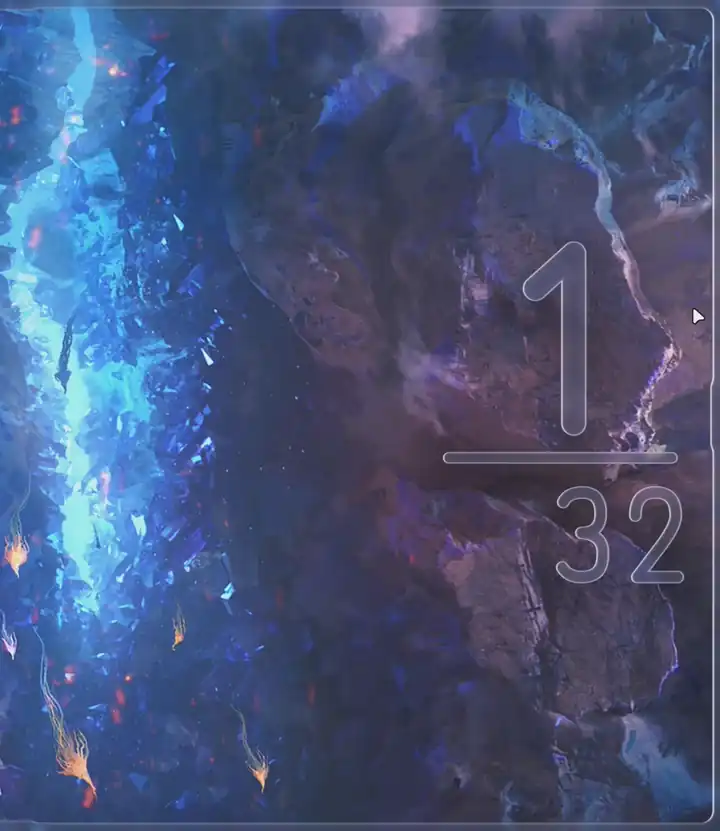
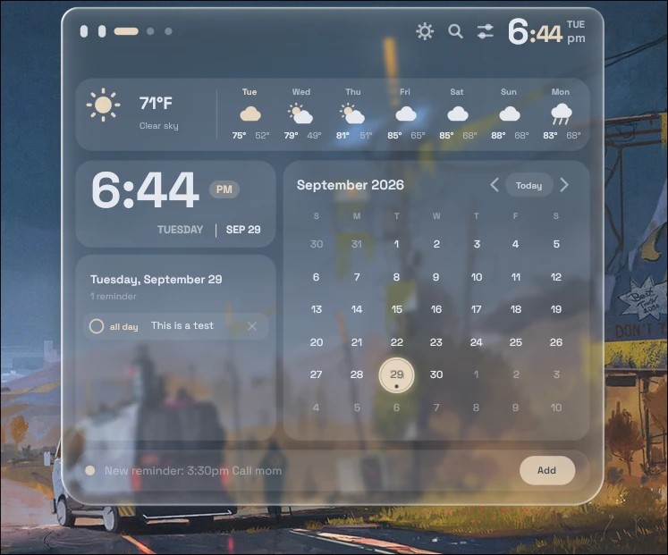
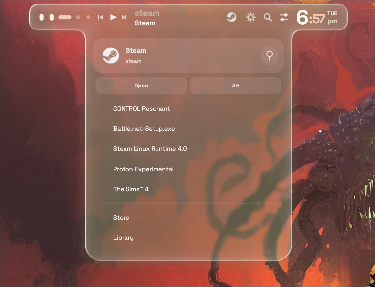
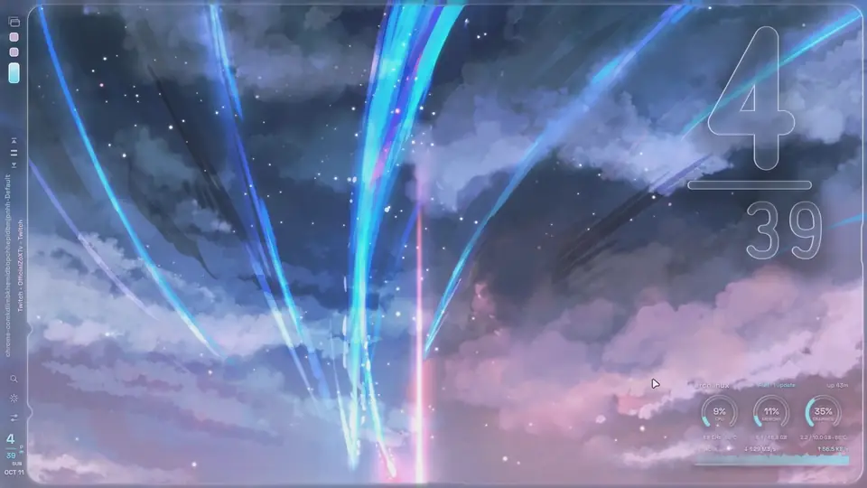
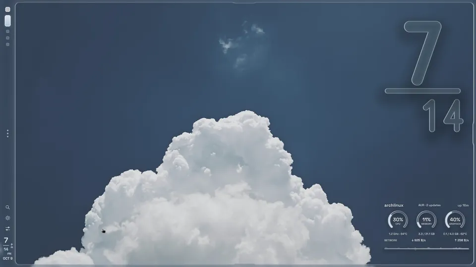
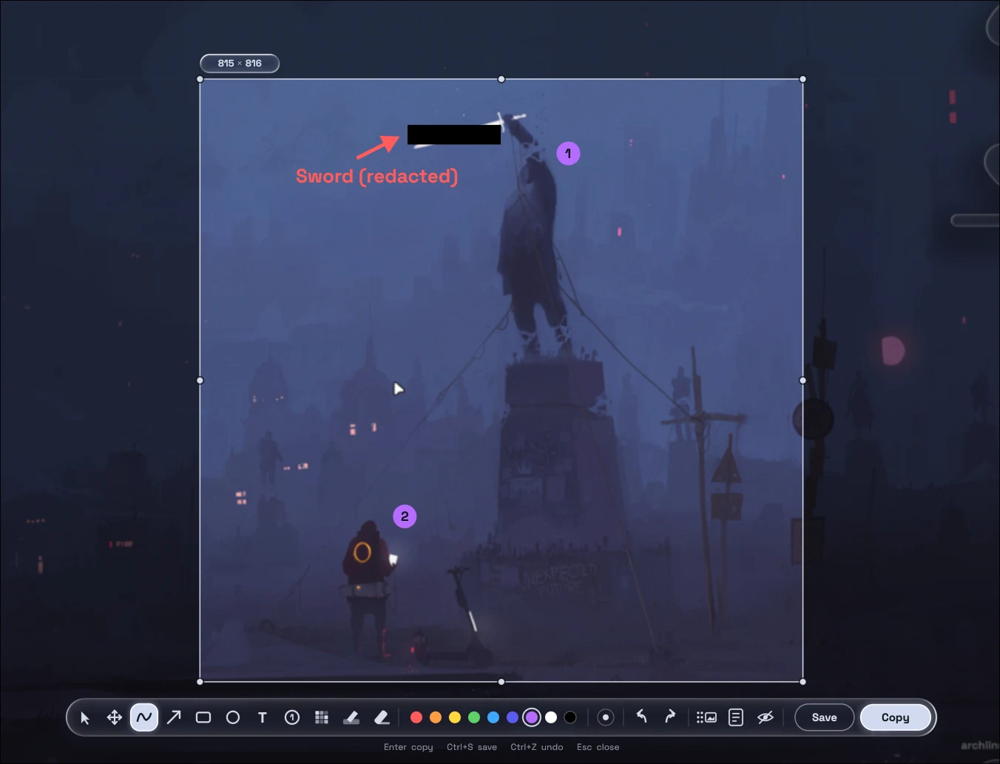

# صور مرجعية للواجهة والشيل

**هذه الصور والعروض من ملفات المشروع الأصلية، وليست لقطات من تشغيل ISO Nahj الجديدة.** لم يتم تعديل الصور أو إعادة رسمها. بعض ملفات WebP متحركة؛ افتح الملف الأصلي إذا لم تعرض المعاينة الحركة.

المصدر: `assets/screenshots/` في commit `f8a930e5008c98a04eedf195a27476e272712da2`. الخلفيات وأرقام الإصدارات الظاهرة تخص الصور الأصلية، ولا تثبت مواصفات النسخة الجديدة.

## سطح المكتب ولوحة المعلومات

## حركات الشريط واللوحات

## جولة في الواجهة

## مركز التحكم

## مشغّل التطبيقات

## لوحة المكتب

## التقويم

## المشغل والنوافذ

## شريط النظام

## الإعدادات

## منتقي الخلفيات

## شاشة القفل

## أداة تصوير الشاشة

